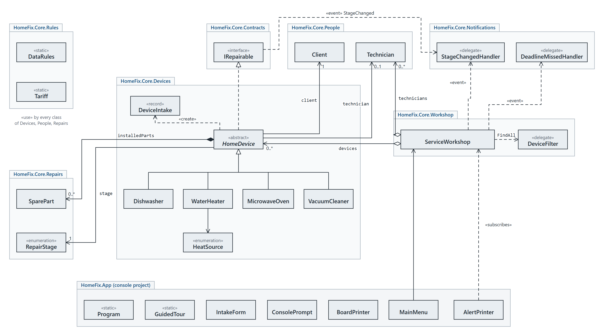

<!-- &lrm; marks keep English code in its own order inside the Arabic lines on GitHub. -->
<div dir="rtl">

# ورشة HomeFix لصيانة الأجهزة المنزلية

HomeFix برنامج Console مكتوب بـ C#&lrm; على &lrm;.NET 8 لورشة تصلح الأجهزة المنزلية. كل جهاز يدخل الورشة ببطاقة استلام، ثم ينتقل بين ست مراحل من الفحص حتى عودته إلى صاحبه، ويُسعَّر إصلاحه بقواعد نوعه هو. حين يجهز الجهاز تصل إلى صاحبه رسالة، وحين يفوت موعده يصل إلى المدير تنبيه.

الوظيفة الأولى في مقرر **البرمجة والتصميم غرضية التوجه** &lrm;`TIC_IPG203_F25`&lrm;.

## ما يفعله البرنامج

- **أربعة أنواع من الأجهزة** لكل منها قواعد تسعير خاصة: غسالة الصحون &lrm;`Dishwasher`&lrm;، وسخان الماء &lrm;`WaterHeater`&lrm; (كهربائي أو غاز أو شمسي)، والميكروويف &lrm;`MicrowaveOven`&lrm;، والمكنسة الكهربائية &lrm;`VacuumCleaner`&lrm;.
- **ست مراحل** يمر بها كل جهاز، ولا يُقبل الانتقال إلا إلى المرحلة المسموحة:
  &lrm;`Waiting`&lrm; ← &lrm;`Diagnosed`&lrm; ← (&lrm;`AwaitingParts`&lrm;) ← &lrm;`InRepair`&lrm; ← &lrm;`ReadyForPickup`&lrm; ← &lrm;`Returned`&lrm;
- **الكلفة**: رسم الفحص + القطع المركّبة + أجر العمل (ساعات × أجر الفني الخاص به) + رسوم يضيفها كل نوع. الكفالة تغطي الإصلاح، والعمل المستعجل يزيد الأجر 25 %.
- **قاعدة أمان**: سخان الغاز لا يفتحه إلا فني يحمل شهادة الغاز.
- **تنبيهات بالأحداث**: رسالة للزبون عند جاهزية جهازه، وتنبيه للمدير عن كل جهاز تجاوز موعده (مرة واحدة لكل جهاز).
- **قوائم وبحث**: الأجهزة التي أُصلحت، والتي ما تزال في الصيانة، وخيار بحث كل شرط فيه delegate من النوع &lrm;`DeviceFilter`&lrm; (الكفالة، الاستعجال، التأخر، جوال الزبون، الكلفة).
- **إحصاءات مشتركة** في أعضاء static: عدد الأجهزة في كل مرحلة، والمبلغ المحصّل من الأعمال المغلقة.

## المتطلبات وأين تجدها في الكود

| المتطلب | أين يظهر |
| --- | --- |
| التجريد: واجهة وفئة مجردة بدالة كلفة مجردة | الواجهة &lrm;`IRepairable`&lrm; والفئة المجردة &lrm;`HomeDevice`&lrm; بالدالة &lrm;`ComputeRepairCost()`&lrm; والخاصية &lrm;`Kind`&lrm; |
| الوراثة: ثلاث فئات مشتقة على الأقل | أربع فئات ترث &lrm;`HomeDevice`&lrm; وكل منها تعيد تعريف &lrm;`ComputeRepairCost()`&lrm; و&lrm;`Describe()`&lrm; |
| تعدد الأشكال | قائمة واحدة &lrm;`List<HomeDevice>`&lrm; في &lrm;`ServiceWorkshop`&lrm; تُعالج بحلقة واحدة في &lrm;`TotalRepairCost()`&lrm; و&lrm;`StatusBoard()`&lrm;؛ والدالة الافتراضية &lrm;`CheckTechnician()`&lrm; تعيد تعريفها &lrm;`WaterHeater`&lrm; فقط |
| التغليف | كل الحقول &lrm;`private`&lrm;، والخصائص للقراءة فقط، والمرحلة لا تتغير إلا من داخل الفئة عبر &lrm;`EnterStage()`&lrm;، والقوائم تُعرض &lrm;`IReadOnlyList`&lrm; |
| قيم ثابتة وللقراءة فقط | ثوابت &lrm;`const`&lrm; للرسوم في كل فئة وفي &lrm;`Tariff`&lrm;، وحقول &lrm;`readonly`&lrm; تُحدد في الباني فقط، وبطاقة الاستلام &lrm;`DeviceIntake`&lrm; بخصائص &lrm;`init`&lrm; |
| المندوبات والأحداث | المندوبات &lrm;`StageChangedHandler`&lrm; و&lrm;`DeadlineMissedHandler`&lrm; و&lrm;`DeviceFilter`&lrm;؛ والأحداث &lrm;`StageChanged`&lrm; و&lrm;`RepairFinished`&lrm; و&lrm;`DeadlineMissed`&lrm; |
| فئة static للتحقق | &lrm;`DataRules`&lrm;: الرقم التسلسلي، الجوال السوري، الاسم، التواريخ، الساعات، الأسعار |
| خاصية static لمجموع أو عدد حسب الحالة | &lrm;`HomeDevice.CountAt(stage)`&lrm; و&lrm;`InWorkshopCount`&lrm; و&lrm;`ReadyForPickupCount`&lrm; و&lrm;`TotalCollected`&lrm; |

## التشغيل

تحتاج إلى [&lrm;.NET 8 SDK](https://dotnet.microsoft.com/download/dotnet/8.0) أو Visual Studio 2022 (الإصدار 17.8 أو أحدث).

**من Visual Studio:** افتح &lrm;`HomeFixWorkshop.sln`&lrm;، واجعل &lrm;`HomeFix.App`&lrm; مشروع البدء (Set as Startup Project)، ثم اضغط F5.

**من سطر الأوامر** داخل مجلد المستودع:

</div>

```bash
dotnet run --project src/HomeFix.App              # the interactive menu
dotnet run --project src/HomeFix.App -- --tour    # a guided tour of every requirement, then exit
dotnet test                                       # the automated tests
```

<div dir="rtl">

تبدأ القائمة التفاعلية وفي الورشة أربعة أجهزة في مراحل مختلفة (من الجولة نفسها)، فيمكن تجربة كل الخيارات فورًا. التواريخ تُكتب بالشكل &lrm;`dd/MM/yyyy`&lrm;، والكسور بنقطة مثل &lrm;`1.5`&lrm;.

## الاختبارات

المشروع &lrm;`HomeFix.Tests`&lrm; (xUnit) فيه **166 اختبارًا** تغطي: تسعير كل نوع مع الكفالة والاستعجال، وكل انتقال مسموح أو مرفوض بين المراحل، والأحداث (تُطلق مرة واحدة، ويُلغى الاشتراك بعد التسليم)، والأعضاء static، وقواعد &lrm;`DataRules`&lrm;، وتعدد الأشكال في الورشة، وفحصًا بالانعكاس (Reflection) يتأكد أن كل حقل في المكتبة &lrm;`private`&lrm; وأن لا خاصية تُكتب من الخارج، وجلسة كاملة على القائمة بإدخال مكتوب.

## بنية المستودع

</div>

```text
HomeFixWorkshop.sln
src/
  HomeFix.Core/              the workshop itself, no console code
    Contracts/               IRepairable
    Devices/                 HomeDevice, the four kinds, DeviceIntake, HeatSource
    People/                  Client, Technician
    Repairs/                 RepairStage, SparePart
    Rules/                   DataRules (validation), Tariff (shared charges)
    Notifications/           StageChangedHandler, DeadlineMissedHandler (delegates)
    Workshop/                ServiceWorkshop, DeviceFilter (delegate)
  HomeFix.App/               the console program
    Input/                   ConsolePrompt: asks again until the answer is valid
    Output/                  BoardPrinter, AlertPrinter (listens to the events)
    Screens/                 MainMenu, IntakeForm
    Demo/                    GuidedTour: the guided tour
    Program.cs
tests/
  HomeFix.Tests/             xUnit tests
docs/
  diagrams/                  the UML diagrams, SVG and PNG
```

<div dir="rtl">

## مخططات UML



بقية المخططات في [&lrm;`docs/diagrams`&lrm;](docs/diagrams):
[الوراثة والتجريد](docs/diagrams/device-hierarchy.png) ·
[الواجهة والأنواع الصغيرة](docs/diagrams/domain-types.png) ·
[الفئات الثابتة](docs/diagrams/rules.png) ·
[الورشة والمندوبات والأحداث](docs/diagrams/workshop-events.png) ·
[طبقة الواجهة](docs/diagrams/console-layer.png) ·
[مراحل الإصلاح](docs/diagrams/repair-stages.png) ·
[تسلسل الأحداث](docs/diagrams/event-sequence.png)

## الفريق

| # | الاسم | حساب GitHub | الرقم الجامعي | ما نفّذه |
| --- | --- | --- | --- | --- |
| 1 | أسامة أيمن القاسم |Osama495|osama_327070| تصميم بنية البرنامج ،التجريد ،الوراثة ,تعدد الاشكال ، التغليف ، فئات الاجهزة وحساب تكاليف الاصلاح ،إدارة مستودع GitHub|
| 2 |خالد ابراهيم الصويص |Khaldaks|Khaled_359475|مراحعة وتطوير إدارة الورشة، التفويض والاحداث، واجهة console، تشغيل الاختبارات، مخطط UML، والتوثيق|

</div>
